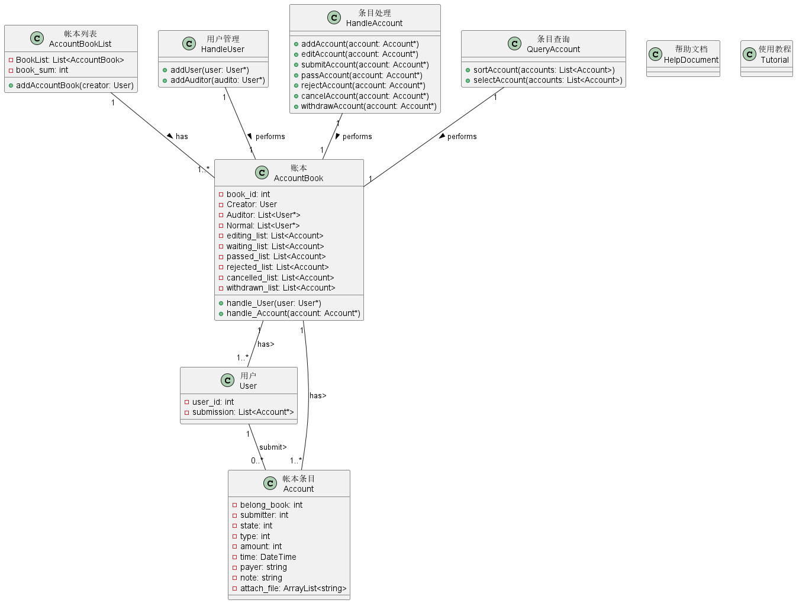
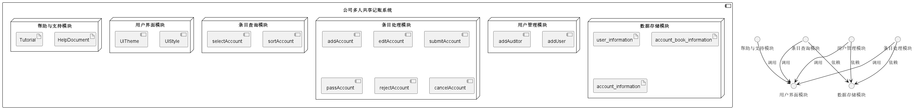
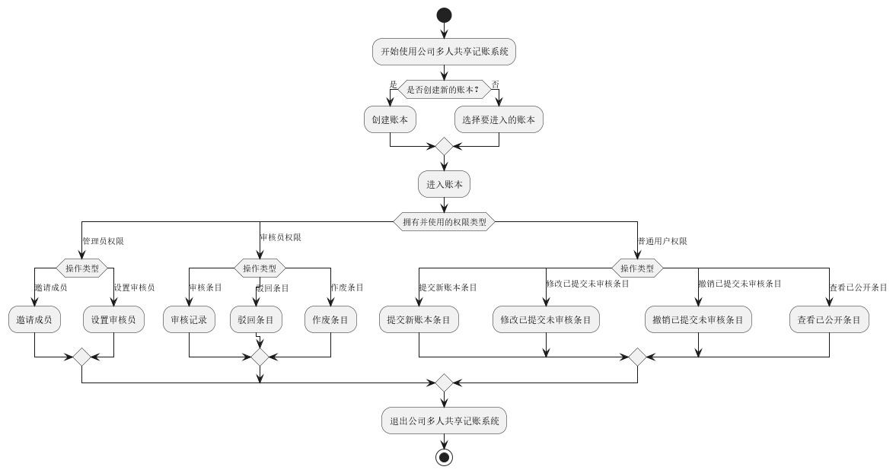
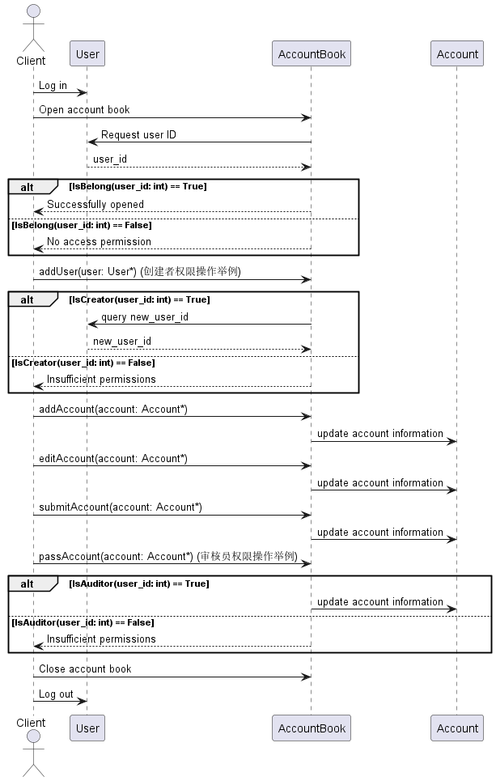
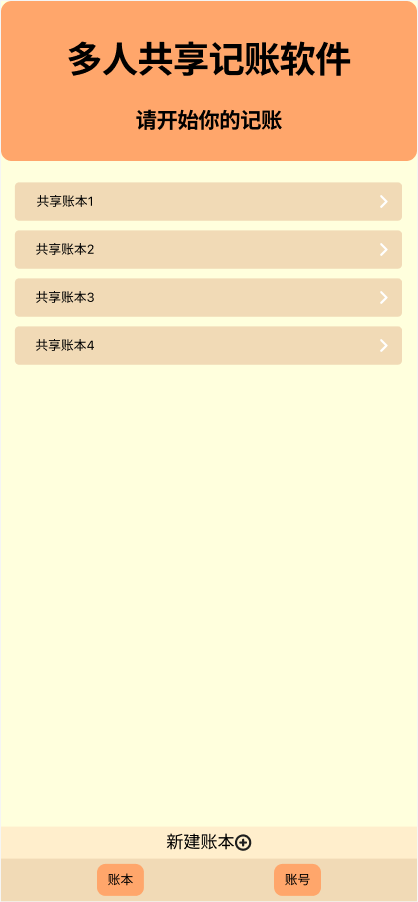
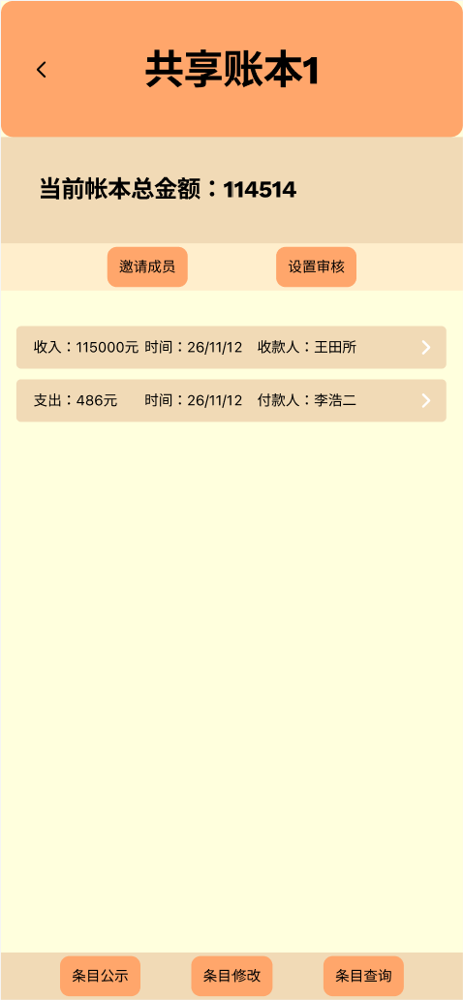
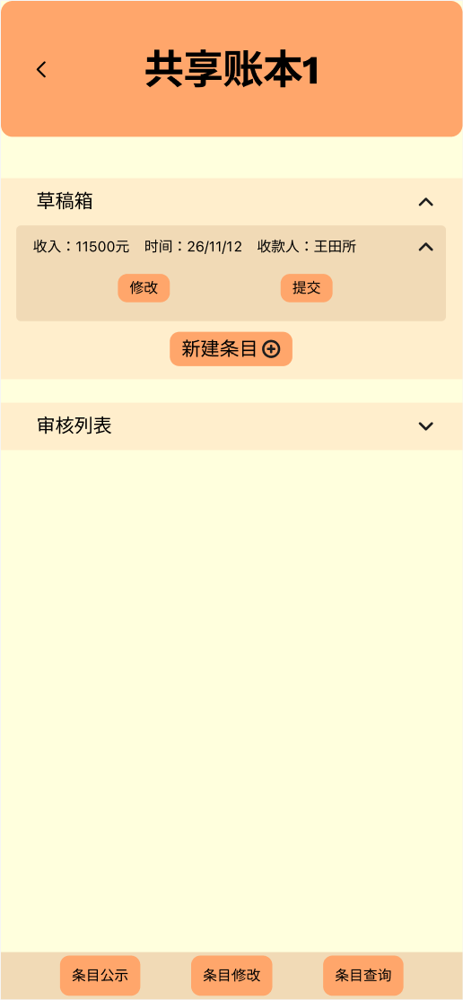
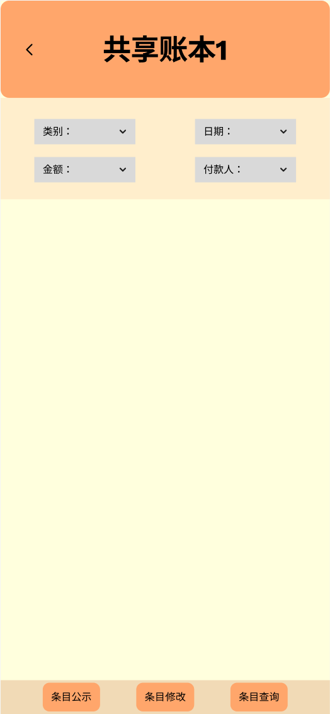

# 软件设计与建模报告

项目名称：公司多人共享记账系统

学号：231870149	姓名：华梓涵

日期：2026/11/12

### 一、软件主要功能

##### 1.主要功能

- 账本创建与成员管理：用户可以创建新的账本，账本创建者可以邀请成员和设置审核员
- 普通账本条目操作：特定账本下的所有成员可以在该账本内进行添加条目、编辑自己提交的且未通过审核的条目、撤回自己提交的且未通过审核的条目、提交条目、查看已通过审核公开的条目
- 权限账本条目操作：特定账本下的审核员可以在该账本内进行审核条目、驳回条目和作废条目操作
- 帐本条目查询：按记录类别（如已通过和待审核），金额（按具体金额范围，如1000-2000），收支类型，发生日期（今日、昨日、3天前、1个月前、2个月前）以及付款人信息进行筛选，查询和排序。

##### 2.功能模块

- 用户管理模块
- 条目处理模块
- 条目查询模块
- 用户界面模块

### 二、软件架构UML图

##### 1.结构性图（一）

UML类图

1.帐本列表（**AccountBookList**）

- 记录所有账本

2.账本（**AccountBook**）

- 核心类，单个账本，包含成员身份信息与权限信息、条目信息及相应处理的接口

3.用户（**User**）

- 核心类，用户，包含用户的个人信息及所在账本列表

4.帐本条目（**Account**）

- 核心类，帐本条目，包括条目的所属账本、提交者、状态类型、收支类型、时间、支付者和备注等信息

5.用户管理（**HandleUser**）

- 包含用户管理的函数接口

6.条目处理（**HandleAccount**）

- 包含条目处理的函数接口

7.条目查询（**QueryAccount**）

- 包含条目查询的函数接口

8.帮助文档（**HelpDocument**）

- 提供使用教程，帮助用户了解如何使用系统。

9.使用教程（**Tutorial**）

- 提供使用教程，帮助用户了解如何使用系统。

##### 2.结构性图（二）

UML组件图

**组件图说明**

​	组件图展示了共享记账系统App 的模块化结构，将系统分解为多个功能模块，每个模块负责特定的功能。这些模块通过明确的依赖关系相互协作，共同构成整个应用程序。

1.数据存储模块（**DataStore**）

- 用户、账本、条目信息的存取

2.用户管理模块（**HandleUser**）

- 负责实现账本内的邀请成员和设置审核员

3.条目处理模块（**HandleAccount**）

- 负责实现对条目的添加、编辑、撤回、提交、审核、驳回、作废操作

4.条目查询模块（**QueryAccount**）

- 负责实现对于账本的筛选和排序功能

5.用户界面模块（**UserInterface**）

- 负责实现UI界面

6.帮助与支持模块（**HelpSupport**）

- 提供用户指南和教程，帮助用户了解如何使用应用的各项功能。

**依赖关系**

- 用户管理模块依赖数据存储模块处理数据
- 条目处理模块依赖数据存储模块处理数据
- 条目查询模块依赖数据存储模块处理数据
- 用户管理模块调用用户界面模块来和用户交互
- 条目处理模块调用用户界面模块来和用户交互
- 条目查询模块调用用户界面模块来和用户交互
- 帮助与支持模块调用用户界面模块来和用户交互

##### 3.行为性图

UML活动图

**活动图说明**

活动图概述了用户在使用多人共享记账系统时的操作流程，从启动应用到选择是创建新的账本还是进入已有的账本，在账本中根据自身拥有的权限类型进行不同的操作，到最后退出程序。它展示了用户如何通过决策选择不同操作和不同权限下的操作分支情况。

整个活动图旨在帮助开发者和用户能更直观地看懂该系统的功能。

##### 4.交互性图

UML时序图

**时序图说明**

时序图展示了用户与多人共享记账系统中各个组件之间的交互流程。

1.**Log in**

- 用户输入个人信息，登录账号。

2.**Open account book**

- 用户登录账号后打开一个账本。

3.**Request user ID**、**user_id**和分支判断

- 账本获取用户的账号信息，判断该账号是否在该账本中。若账号在账本中，则用户成功打开账本；否则用户收到没有进入许可的报错。

4.**addUser(user: User*)** (创建者权限操作举例)

- 以邀请成员操作为例分析创建者权限操作。用户向账本提交操作申请和操作信息，若用户账号在账本中拥有创建者权限，则账本向被添加成员账号获取用户信息，被添加成员账号返回用户信息，账本将新成员数据加入账本中；否则用户收到没有足够权限的报错。

5.**addAccount**，**editAccount**和**submitAccount**

- 用户进行普通成员权限操作。用户向账本提交操作申请和操作信息，账本向条目发送条目信息更新内容。

6.**passAccount(account: Account*) **(审核员权限操作举例)

- 以通过条目操作为例分析审核员权限操作。用户向账本提交操作申请和操作信息，若用户账号在账本中拥有审核员权限，则账本向条目发送条目信息更新内容；否则用户收到没有足够权限的报错。

7.**Close account book**

- 用户关闭账本

8.**Log out**

- 用户退出账号

### 三、UI界面

根据UML图中的模块，使用Figma UI设计工具进行UI界面设计，包含了首页、账本公示页面、条目管理页面和条目查询页面。

UI界面整体采用暖黄色风格，以提升用户使用时的舒适度。

##### 1.UI界面 - 首页

**功能描述**

- 可以选择下方账号按钮，然后登录、登出账号或修改用户信息。
- 可以选择下方账本按钮，然后点击上方已建立的账本选择进入。
- 可以选择下方账本按钮，然后点击“新建账本”按钮创建新的账本。

##### 2.UI界面 - 条目公示与成员管理

**功能描述**

- 进入账本后进入该页面；若原本处于“条目修改”或者“条目查询”页面，则点击下方“条目公示”按钮可以进入该页面。
- 可以在该页面查看已通过审核并公示的帐本条目信息；点击公示条目右侧的向右箭头符号可以展示该条目更详细的信息。
- 公示条目的上方会展示当前已公示条目的总收支情况。
- 如果当前用户是账本的创建者还可以在上方选择邀请成员和设置审核员。

##### 3.UI界面 - 条目管理

**功能描述**

- 进入账本后点击下方“条目修改”按钮可以进入该页面。
- 所有用户都拥有一个草稿箱，可以在草稿箱内对已有的条目草稿选择修改或提交；也可以选择新建条目草稿。
- 如果当前用户是该账本的审核员，还有一个审核列表，点击右侧向下箭头符号可展开当前的审核列表。

##### UI界面 - 条目查询

**功能描述**

- 进入账本后点击下方“条目查询”按钮可以进入该页面。
- 可以根据上方选择的“类别”、“日期”、“金额”和“付款人”限制条件筛选出满足条件的账本条目进行展示

### 四、大模型使用情况

未使用
